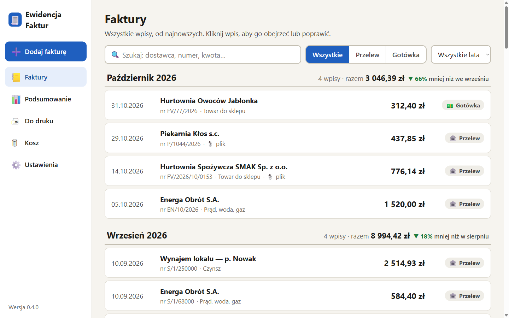
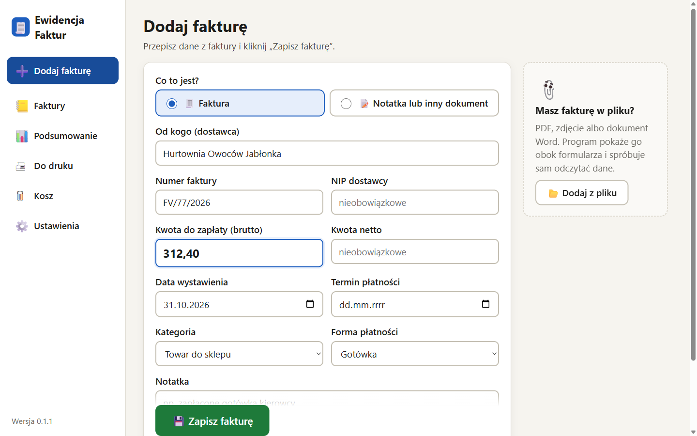
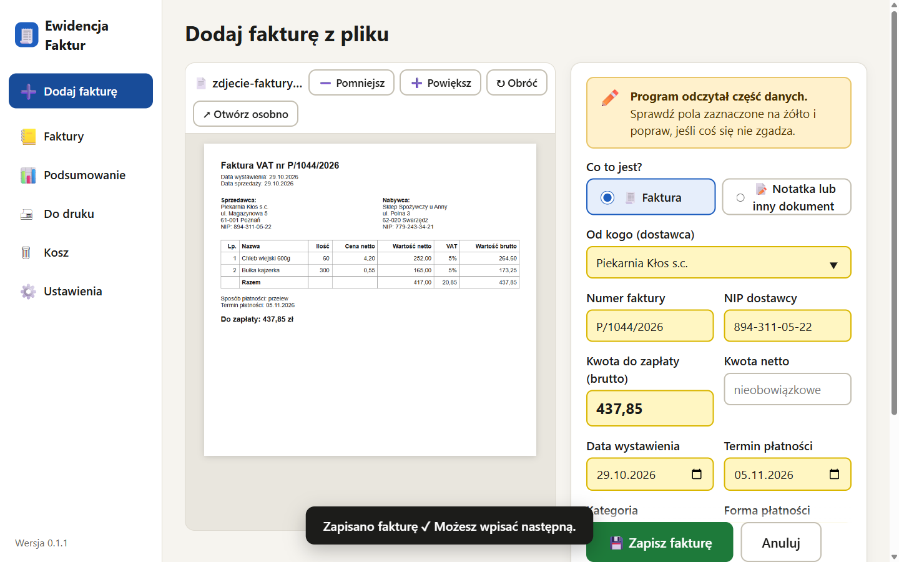
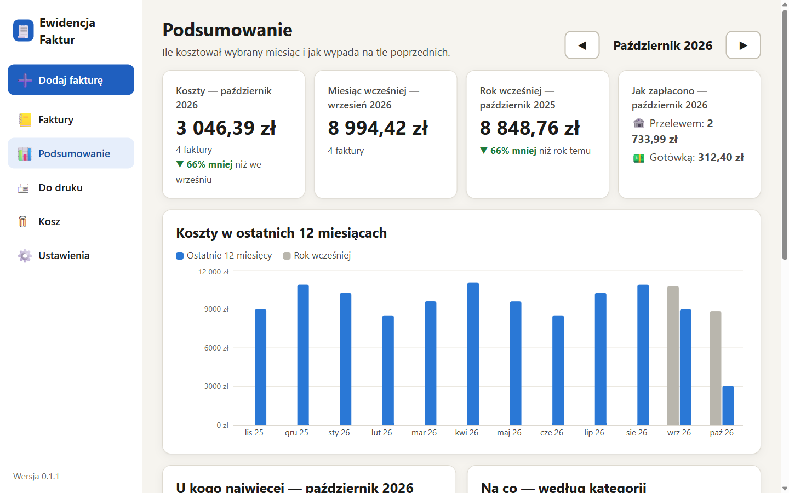
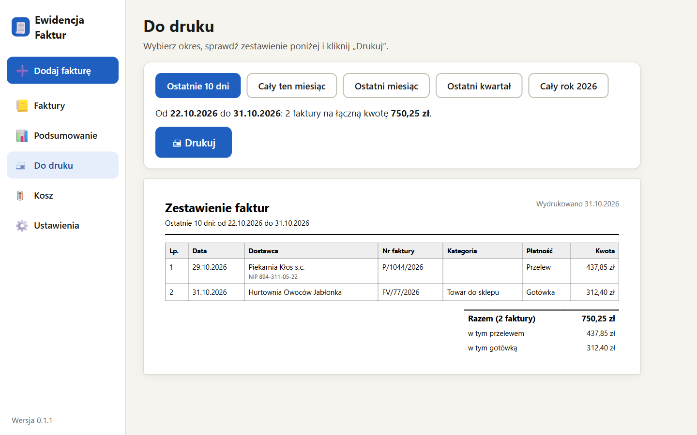

<p align="center">
  
</p>

<h1 align="center">Ewidencja Faktur</h1>

<p align="center">
  A simple, offline invoice ledger for Windows — built for a small grocery shop run by someone
  who grew up without computers.
</p>

<p align="center">
  
</p>

## Why

It was written for a family member who runs a small grocery store and kept every cost invoice in
a paper notebook, copying each one by hand. This app replaces the notebook: type the invoice
into a simple form (or add a PDF or photo and let it read the fields), and it is filed,
searchable, summed up per month, ready to print and backed up.

The user interface is in **Polish** (that is who it is for); the code and documentation are in
English.

## Features

- **Typing invoices in by hand is the default** — one form with supplier, number, amount, dates,
  category and payment method (bank transfer / cash). Known suppliers are remembered.
- **Optionally from a file** — PDF, photos (JPG/PNG) or Word (.docx), from a separate side panel or
  by drag & drop. The document is shown next to the form and its fields are **read automatically**:
  PDF text layer when available, otherwise **offline OCR** (Tesseract, Polish model bundled).
  Every guessed field is highlighted so it gets checked before saving.
- **The notebook view** — entries grouped by month with totals and month-over-month change,
  one search box, filter by payment method.
- **Duplicate warnings** — same supplier and invoice number, or the same file added twice.
- **Summary** — costs per month vs. the year before, transfer vs. cash, top suppliers, categories,
  and a per-supplier comparison with the previous month.
- **Ready to print** — for the last 10 days, this month, last month, last quarter or this year:
  either every invoice, or a one-page summary (per day or month, per category, top suppliers).
- **CSV import** of many invoices at once (e.g. history transcribed from the notebook), with a
  preview, duplicate detection and one-click undo — see [docs/IMPORT.md](docs/IMPORT.md).
- **Safe by default** — no save button to forget, a 30-day recycle bin, daily automatic backups
  (to OneDrive when available) and one-click restore.
- **Automatic updates** from GitHub Releases, downloaded quietly and installed with one click;
  a "what's new" note (Polish / English) is shown after each update.

| Adding an invoice by hand | Adding an invoice from a photo |
| --- | --- |
|  |  |
| **Summary** | **Ready to print** |
|  |  |

## Accessibility choices

The target user is not technical, so the UI deliberately trades density for clarity:
19 px base font, high contrast, 48 px+ click targets, every icon paired with a text label,
one task per screen, plain-language messages ("Zapisano ✓" rather than "Operation completed"),
and nothing destructive without a confirmation and an undo.

## Tech stack

Electron · React · TypeScript · Vite (electron-vite) · SQLite (`node:sqlite`, no native modules) ·
pdf.js · Tesseract.js · mammoth · Recharts · electron-builder · electron-updater

See [docs/ARCHITECTURE.md](docs/ARCHITECTURE.md) for how it fits together and
[docs/REQUIREMENTS.md](docs/REQUIREMENTS.md) for the product requirements.

## Development

Requires Node.js 24+ on Windows.

```bash
npm install
npm run dev          # app with hot reload
npm test             # unit tests (invoice parser, money, NIP, warnings, summaries)
npm run test:e2e     # drives the real app: manual entry, PDF + photo import with OCR, print view, screenshots
npm run dist         # builds the installer into dist/
```

## Releasing an update

See [docs/RELEASING.md](docs/RELEASING.md). In short: bump the version, add a `changelog.json`
entry, push a `vX.Y.Z` tag — GitHub Actions builds the installer and publishes the release, and
installed apps pick it up within a few hours.

## Privacy

All data stays on the user's computer (`%APPDATA%\Ewidencja Faktur`) and in the backup folder
they choose. Nothing is uploaded anywhere; the only network request is the update check against
this repository's releases.

## License

[MIT](LICENSE)
